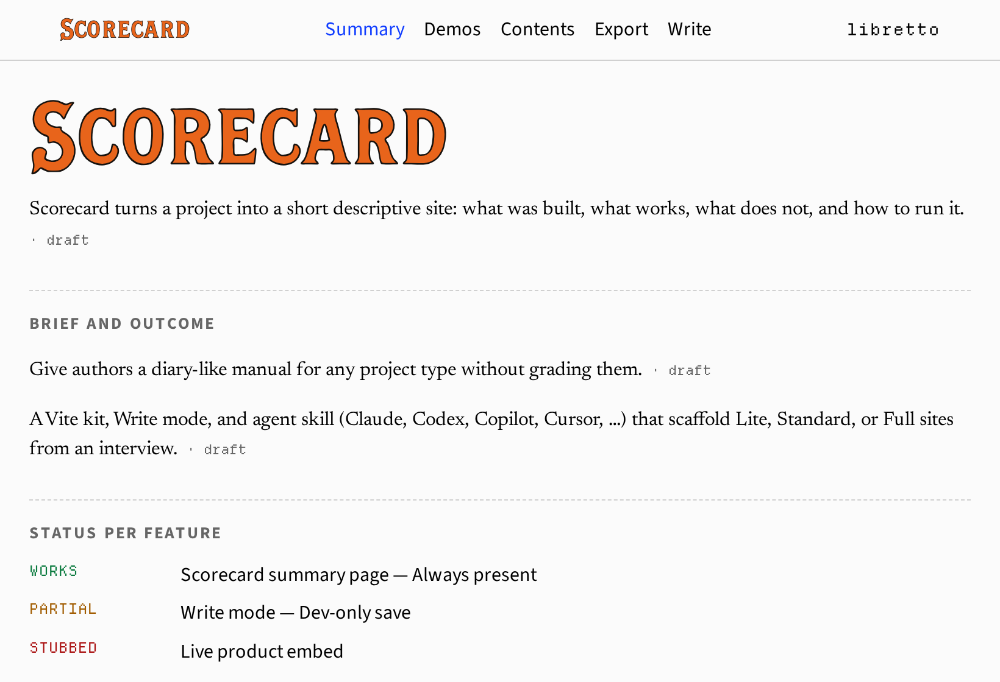
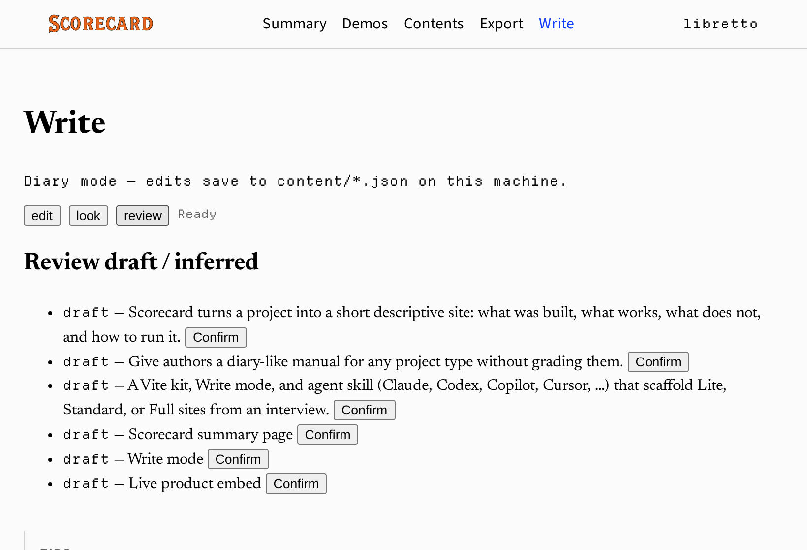
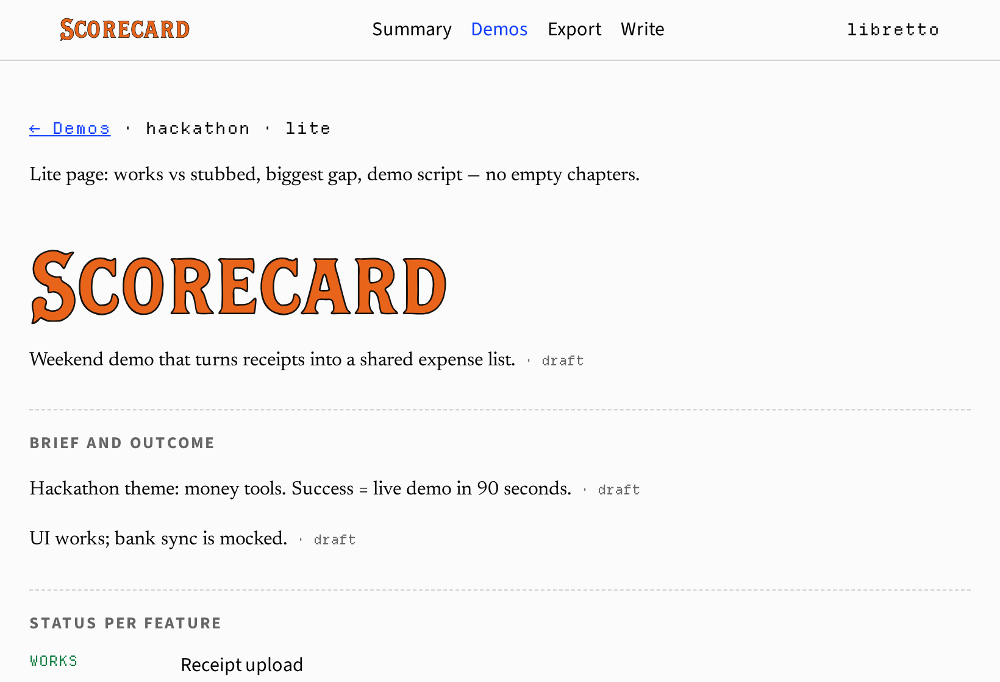
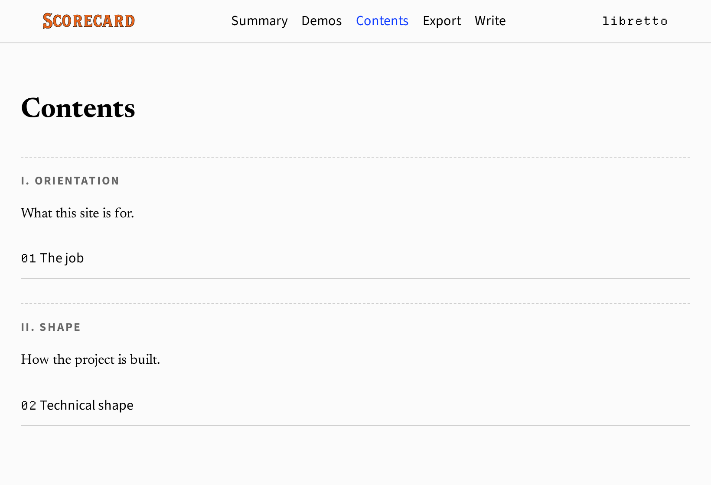
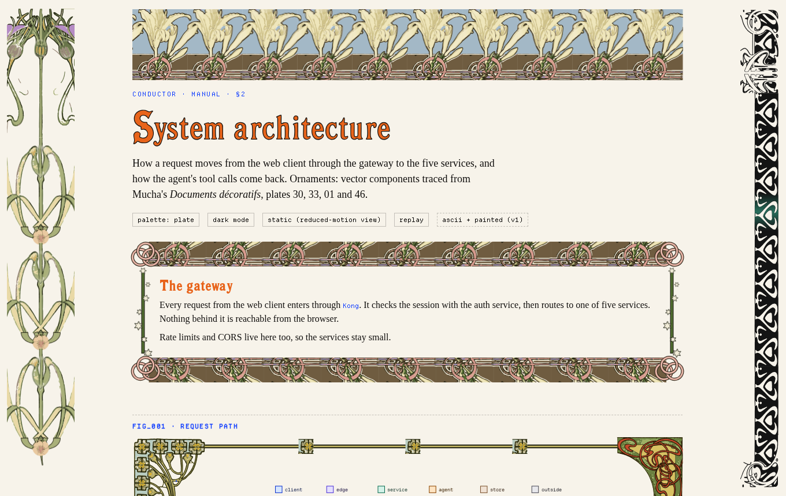

<p align="center">
  
</p>

<p align="center">
  <b>Descriptive project manuals for any codebase.</b><br>
  What was built, what works, what doesn’t, and how to run it, readable in about two minutes.<br>
  <b>Never a grade.</b>
</p>

<p align="center">
  <a href="LICENSE"></a>
  
  
  <a href="skills/scorecard/SKILL.md"></a>
</p>

<p align="center">
  <a href="#install">Install</a> ·
  <a href="#quick-start">Quick start</a> ·
  <a href="#a-tour">Tour</a> ·
  <a href="#the-cli">CLI</a> ·
  <a href="#how-the-content-works">Content</a> ·
  <a href="#privacy-and-security">Security</a> ·
  <a href="#credits-and-licenses">Credits</a>
</p>

<p align="center"></p>

## What Scorecard does

Scorecard is an **agent skill plus a small web kit**. You point your coding agent (Cursor, Claude Code, Codex, GitHub Copilot, or any agent that reads Agent Skills) at a repository. It interviews you, scans the code, and writes a short, honest site about the work:

| Part | What the reader learns |
|---|---|
| **The job** | One sentence: for whom, and what it does |
| **Brief vs outcome** | What you set out to do, next to what actually shipped |
| **Status per feature** | `works` · `partial` · `stubbed` · `cut`, plus the biggest gap |
| **Built vs borrowed** | Your own work, separated from libraries, templates, APIs and starters |
| **Proof** | A demo, screenshot, test or metric, only when one is real |
| **Run it** | Setup steps and a 60-second demo script |
| **Next** | What you’d do with more time |

You finish it yourself in **Write mode**, a diary-style editor in the browser, and publish a static build.

### Why it never grades

READMEs and slide decks tend to flatten finished work into either hype or silence. Course markers, hackathon judges, teammates and future-you all need the same thing: an honest map of what is real, what is mocked, and how to run it. They don’t need a score, a leaderboard or a performance review.

AI tools make it easy to *generate* docs that sound finished. Scorecard steers them toward **evidence** instead:

- 🖋 **Draft until you confirm.** Agents can only write `draft` or `inferred` claims. Only you can mark something `confirmed`, in Write → Review.
- 🔎 **Inferred means cited.** An inferred claim must point at a file path or a commit.
- 🛡 **Your words are safe.** Re-running the skill updates generated text and *proposes* diffs for anything you wrote; it never overwrites it.
- 🌱 **Sized to the work.** **Lite** (one page), **Standard** (chapters when earned) or **Full** (long-lived, multi-service). Empty sections stay hidden, so a weekend hackathon never gets a fake branch history.

| Who | Why it fits |
|---|---|
| **Students and coursework** | A requirements map with file paths. Partial work stays partial. |
| **Hackathon teams** | A Lite page plus a 90-second demo script, with stubs called out |
| **Solo builders** | CLIs and side projects described without overselling |
| **Small teams** | Shared ownership areas, with no invented individual glory |

> Want to see a Full manual? [Libretto](https://github.com/KitheK/libretto) is one, live at [499team1.com/make](https://499team1.com/make).

## A tour

These are real screenshots of the kit in this repo, running `npx scorecard-kit dev` on its own `content/`.

<table>
  <tr>
    <td width="50%" valign="top">
      
      <p><b>The summary page.</b> Job, brief vs outcome, status per feature and built vs borrowed. Every claim shows its provenance tag.</p>
    </td>
    <td width="50%" valign="top">
      
      <p><b>Write mode</b> (<code>/write</code>, dev only). Edit like a diary, choose the look, and confirm claims in Review. Saves go straight to <code>content/*.json</code>.</p>
    </td>
  </tr>
  <tr>
    <td width="50%" valign="top">
      
      <p><b>Demo packs</b> (<code>/demos</code>). Working pages for five repo shapes. This is the hackathon one: receipt upload works, bank sync is stubbed, and the page says so.</p>
    </td>
    <td width="50%" valign="top">
      
      <p><b>Chapters, when earned.</b> Standard and Full manuals get a contents page, with parts and chapters from <code>manual.json</code>. Lite stays one page.</p>
    </td>
  </tr>
</table>

<details>
<summary><b>The five demo packs</b></summary>

<br>

Run `npx scorecard-kit demos` inside the kit, or open `/demos` while `npx scorecard-kit dev` is running.

| Demo | Repo shape | Deep link |
|---|---|---|
| **Hackathon weekend** | Greenfield demo with mocked bank sync | `/demos/hackathon` |
| **Personal CLI** | Solo tool, brittle edges called out | `/demos/personal-cli` |
| **Course assignment** | Rubric map, partial persistence | `/demos/assignment` |
| **Team product** | Multi-owner areas, no fake metrics | `/demos/team` |
| **No README** | Sparse repo, draft-heavy until you add your voice | `/demos/no-readme` |

</details>

<details>
<summary><b>The look: typefaces and ornaments</b></summary>

<br>

Manuals are set in **Libretto Paléologue**, a display face drawn after Jean de Paléologue’s 1900 lithograph posters, with Newsreader, Source Sans 3 and Departure Mono. Run `npx scorecard-kit look` to browse the schemes (`libretto`, `plate`, `poster`, `plain`) and ornaments, then name the ones you want when the skill asks. If you’d rather have no ornaments, ask for the **plain** scheme.

<p align="center"></p>
<p align="center"></p>

</details>

<p align="center"></p>

## Quick start

1. **Install the skill** for your agent. See [Install](#install) below; it takes about a minute.
2. **Open your project** in that agent and ask:
   > Use the scorecard skill on this repo. Infer first, confirm with me, scaffold `./scorecard`, then hand off to Write mode.
3. **Answer a few short batches of questions.** The skill suggests answers from the code, and you confirm or correct them. Skipping is fine; skipped items stay `draft`.
4. **Finish it in Write mode.** The skill copies the kit into `./scorecard`, then:
   ```bash
   cd scorecard
   npx scorecard-kit dev      # opens Write mode in your browser (port 5199, or the next free one)
   ```
5. **Publish.**
   ```bash
   npx scorecard-kit build    # static site in scorecard/dist/, with no Write mode or save endpoint
   ```

> [!TIP]
> Just want to look around first? You don’t need an agent:
> ```bash
> git clone https://github.com/KitheK/scorecard.git
> cd scorecard
> npm install
> npx scorecard-kit demos
> ```

<p align="center"></p>

## Install

Scorecard is one **Agent Skill**, [`skills/scorecard/`](skills/scorecard/) (a `SKILL.md` plus references), following the open [Agent Skills](https://agentskills.io) format. The repo is also its own **plugin marketplace** for Cursor ([`.cursor-plugin/`](.cursor-plugin/)) and Claude Code ([`.claude-plugin/`](.claude-plugin/)). It also has an [Agent Plugins](https://agent-plugins.org) manifest ([`plugin.json`](plugin.json)) and ready-made copies of the skill in each agent’s project folder, so **cloning this repo and opening it in any of these agents already works**.

To use Scorecard on *your own* projects, install it once. Cursor and Claude Code install it from GitHub in one step. Every agent also has a manual route, which is a plain folder copy.

| Agent | Where the skill goes | Invoke it with |
|---|---|---|
| [Cursor](#cursor) | **One step:** Customize → import from GitHub → `KitheK/scorecard`. Manual: `~/.cursor/plugins/local/scorecard/` | `/scorecard`, or just ask |
| [Claude Code](#claude-code) | **One step:** `/plugin marketplace add KitheK/scorecard`. Manual: `~/.claude/skills/scorecard/` | `/scorecard:scorecard` (plugin), `/scorecard` (manual), or just ask |
| [OpenAI Codex](#openai-codex) | `~/.agents/skills/scorecard/` or `<project>/.agents/skills/scorecard/` | `$scorecard`, or just ask |
| [GitHub Copilot](#github-copilot-vs-code-and-cli) | `<project>/.github/skills/scorecard/` (+ the agent file), or `~/.copilot/skills/` | The **scorecard** agent, or just ask |
| [Other agents](#any-other-agent) | That agent’s skills folder, or a pointer in `AGENTS.md` | Ask for a Scorecard |

The manual routes start from one shared copy of the repo. This is the same path the skill uses when it scaffolds a kit:

```bash
git clone --depth 1 https://github.com/KitheK/scorecard.git /tmp/scorecard-kit
```

<details>
<summary>Windows (PowerShell)</summary>

```powershell
git clone --depth 1 https://github.com/KitheK/scorecard.git "$env:TEMP\scorecard-kit"
```

</details>

<p align="center"></p>

### Cursor

**One step, from GitHub.** This repo is a Cursor plugin marketplace ([`.cursor-plugin/marketplace.json`](.cursor-plugin/marketplace.json)), named `kithek`, which lists one plugin, `scorecard`.

1. Open **Customize** in the sidebar and import a marketplace **From GitHub Repository**.
2. Paste `https://github.com/KitheK/scorecard`.
3. Find **scorecard** and choose **Install**, at user or project scope.
4. In Agent chat, type `/scorecard`, or just ask for a Scorecard.

**Manual: a local plugin.** Cursor also loads the whole repo as a plugin from `~/.cursor/plugins/local`. It reads `.cursor-plugin/plugin.json` and the logo, and finds the skill in `skills/`.

```bash
git clone https://github.com/KitheK/scorecard.git ~/.cursor/plugins/local/scorecard
```

<details>
<summary>Windows (PowerShell)</summary>

```powershell
git clone https://github.com/KitheK/scorecard.git "$env:USERPROFILE\.cursor\plugins\local\scorecard"
```

</details>

Then restart Cursor (or run **Developer: Reload Window**), and check under **Customize** that **scorecard** appears under Skills.

<details>
<summary>Prefer a plain skill, without the plugin?</summary>

<br>

Cursor also loads skills from `~/.cursor/skills/` and `~/.agents/skills/` (all projects), or from `.cursor/skills/` and `.agents/skills/` inside one project:

```bash
mkdir -p ~/.cursor/skills
cp -R /tmp/scorecard-kit/skills/scorecard ~/.cursor/skills/scorecard
```

</details>

> [!NOTE]
> For the manual route, clone straight into the `local` folder rather than symlinking it, because Cursor skips symlinks that point outside that folder. On Enterprise plans, an admin may have to allow GitHub or local plugin imports. Docs: [Plugins](https://cursor.com/docs/plugins) · [Plugins reference › marketplace manifest](https://cursor.com/docs/reference/plugins) · [Agent Skills](https://cursor.com/docs/skills)

<p align="center"></p>
<br>

<p align="center"></p>

### Claude Code

**One step, from GitHub.** This repo is a Claude Code plugin marketplace ([`.claude-plugin/marketplace.json`](.claude-plugin/marketplace.json)) named `kithek`. Inside a `claude` session, run:

```text
/plugin marketplace add KitheK/scorecard
/plugin install scorecard@kithek
```

To do the same from your shell:

```bash
claude plugin marketplace add KitheK/scorecard
claude plugin install scorecard@kithek
```

Plugin skills are namespaced, so the skill becomes `/scorecard:scorecard`, or you can just ask for a Scorecard. On Claude Code 2.1.275 or later, one command does both steps: `/plugin install scorecard --marketplace KitheK/scorecard`.

**Manual: a plain skill.** Claude Code also loads skills from your personal folder (every project) or from a project’s `.claude/skills/`.

**For every project:**

```bash
mkdir -p ~/.claude/skills
cp -R /tmp/scorecard-kit/skills/scorecard ~/.claude/skills/scorecard
```

<details>
<summary>Windows (PowerShell)</summary>

```powershell
New-Item -ItemType Directory -Force "$env:USERPROFILE\.claude\skills" | Out-Null
Copy-Item -Recurse "$env:TEMP\scorecard-kit\skills\scorecard" "$env:USERPROFILE\.claude\skills\scorecard"
```

</details>

**For one project only** (run it from the project root and commit the folder to share it with your team):

```bash
mkdir -p .claude/skills
cp -R /tmp/scorecard-kit/skills/scorecard .claude/skills/scorecard
```

1. Start a new `claude` session in your project.
2. Check that it loaded by asking *“What skills are available?”*
3. Run `/scorecard`, or ask for a Scorecard of the repo.

> [!NOTE]
> Docs: [Plugin marketplaces](https://code.claude.com/docs/en/plugin-marketplaces) · [Marketplace reference](https://code.claude.com/docs/en/plugins/marketplace-reference) · [Extend Claude with skills](https://code.claude.com/docs/en/skills). The manifests pass `claude plugin validate --strict`.

<p align="center"></p>
<br>

<p align="center"></p>

### OpenAI Codex

Codex (CLI, IDE extension and the ChatGPT desktop app) reads skills from `~/.agents/skills` and from `.agents/skills` in the repo you’re working in.

**For every repo:**

```bash
mkdir -p ~/.agents/skills
cp -R /tmp/scorecard-kit/skills/scorecard ~/.agents/skills/scorecard
```

<details>
<summary>Windows (PowerShell)</summary>

```powershell
New-Item -ItemType Directory -Force "$env:USERPROFILE\.agents\skills" | Out-Null
Copy-Item -Recurse "$env:TEMP\scorecard-kit\skills\scorecard" "$env:USERPROFILE\.agents\skills\scorecard"
```

</details>

**For one repo** (run it from the repo root):

```bash
mkdir -p .agents/skills
cp -R /tmp/scorecard-kit/skills/scorecard .agents/skills/scorecard
```

1. Codex picks up new skills automatically. If Scorecard doesn’t show up, restart Codex.
2. Run `/skills` to check, then type `$scorecard`, or just describe what you want.

> [!NOTE]
> Docs: [Codex › Build skills](https://developers.openai.com/codex/skills). The `.agents/skills/` folder in this repo is the same skill, already in place for anyone who clones it.

<p align="center"></p>
<br>

<p align="center"></p>

### GitHub Copilot (VS Code and CLI)

Copilot uses the skill from `.github/skills/`. It also gets a custom **scorecard** agent, from `.github/agents/scorecard.agent.md`, that you can pick in the chat’s agent dropdown.

**For one project** (run it from the project root; this copies both the skill and the agent):

```bash
mkdir -p .github/skills .github/agents
cp -R /tmp/scorecard-kit/.github/skills/scorecard .github/skills/scorecard
cp /tmp/scorecard-kit/.github/agents/scorecard.agent.md .github/agents/
```

**For every project** (skill only; the agent file points at `.github/skills/`, so it stays per-project):

```bash
mkdir -p ~/.copilot/skills
cp -R /tmp/scorecard-kit/skills/scorecard ~/.copilot/skills/scorecard
```

1. In VS Code, run **Chat: Open Customizations** and check that **scorecard** is listed.
2. In Chat, pick the **scorecard** agent from the agent dropdown, or just ask Copilot for a Scorecard.

> [!NOTE]
> Docs: [Use Agent Skills in VS Code](https://code.visualstudio.com/docs/copilot/customization/agent-skills) · [Custom agents](https://code.visualstudio.com/docs/copilot/customization/custom-agents)

<p align="center"></p>
<br>

<p align="center"></p>

### Any other agent

Scorecard is a standard [Agent Skill](https://agentskills.io): a folder with a `SKILL.md` whose frontmatter holds `name` and `description`, plus plain Markdown references.

- **If your agent supports Agent Skills**, copy `skills/scorecard/` into its skills folder, keeping the folder name `scorecard`.
- **If it only reads [`AGENTS.md`](https://agents.md)**, copy the folder anywhere in your project and point to it from `AGENTS.md`:

```markdown
## Project manual (Scorecard)
When asked to summarise or document what this repo built, follow
`tools/scorecard/SKILL.md` and the files it references. Never grade,
never invent metrics, never set provenance to "confirmed".
```

```bash
mkdir -p tools
cp -R /tmp/scorecard-kit/skills/scorecard tools/scorecard
```

<sub>The <code>tools/scorecard</code> path is just an example; any path works as long as <code>AGENTS.md</code> points to it.</sub>

<p align="center"></p>

#### What’s not supported yet

To keep this list honest:

- **Public marketplace listings.** Scorecard installs straight from this GitHub repo. It isn’t listed in the Cursor Marketplace (which needs Cursor’s review) or in Anthropic’s official plugin directory.
- **npm.** The CLI is called `scorecard-kit`, so it can’t be confused with the unrelated `scorecard` package on npm, but it isn’t published. Run `npx scorecard-kit …` **inside the kit folder**, where it resolves to this repo’s `bin/scorecard.js`, or run `node bin/scorecard.js …` directly.

<p align="center"></p>

## Using it

Some prompts that work well in any of the agents above:

| You say | What happens |
|---|---|
| *“Use the scorecard skill on this repo. Infer first, confirm with me, scaffold `./scorecard`, then hand off to Write mode.”* | The full flow: profile, bounded scan, interview, scaffold, fill, check |
| *“Make a **Lite** Scorecard for this hackathon repo. Keep it to one page with a 90-second demo script.”* | Lite size; empty sections stay hidden |
| *“Quick depth only. I’ll fill in the rest in Write mode.”* | Fewer questions; everything you skip stays `draft` |
| *“Map this coursework to the requirements in `brief.pdf`. No grades.”* | A requirements map with file paths; partial stays partial |
| *“Refresh the Scorecard from the repo. Propose diffs for anything I wrote.”* | Updates `generated` text only and proposes changes to your text |
| *“Use the plain scheme, no ornaments.”* | Same kit, no Mucha |
| *“Just fill it in, I trust you.”* | It still writes everything as `draft`. Confirming is your job. |

<details>
<summary><b>What the skill does, step by step</b></summary>

<br>

1. **Profile** (Stage A): what kind of project, who built it, who it’s for, how big it is, and how deep to go.
2. **Bounded repo scan**: it reads the repo within limits rather than everything.
3. **Interview** (Stages B–D) in batches of 3–5 questions. It suggests answers from the code, and you confirm or correct them.
4. **Look** (Stage E): typeface, scheme and ornaments, or sensible defaults.
5. **Size**: it proposes Lite, Standard or Full, and hides the sections that weren’t earned.
6. **Scaffold** the kit into `./scorecard`, reusing an existing one without touching your text.
7. **Fill** `scorecard/content/*.json` with provenance tags.
8. **Redaction pass** plus `npx scorecard-kit check`.
9. **Hand-off**: `cd scorecard && npx scorecard-kit dev`, and you take it from there in Write mode.

Full detail: [`SKILL.md`](skills/scorecard/SKILL.md) · [`interview.md`](skills/scorecard/interview.md) · [`references/`](skills/scorecard/references/)

</details>

## The CLI

The CLI is `scorecard-kit` (the file is `bin/scorecard.js`) and needs **Node 20 or newer**. Run it from inside the kit folder (see the npm note above) as `npx scorecard-kit <command>`, or as `node bin/scorecard.js <command>`.

| Command | What it does |
|---|---|
| **`dev`** | Installs dependencies if needed, starts Vite on `127.0.0.1` at the first free port from 5199, waits until it answers, then opens **Write mode** at `/write`. Set `SCORECARD_NO_OPEN=1` to skip opening a browser |
| **`demos`** | The same server, opened at `/demos` (the five demo packs) |
| **`build`** | Type-checks and builds a static `dist/`. Write mode and the save endpoint aren’t included |
| **`check`** | Validates every `content/*.json`: `schemaVersion: 1`, no `confirmed` claims written by an agent, and warnings for architecture paths it can’t find |
| **`look`** | Opens `look-gallery.html`, the gallery of schemes, typefaces and ornaments |
| **`export`** | Explains how to print `/export` to PDF, and writes a README badge snippet to `EXPORT-README-SNIPPET.md` |
| **`refresh`** | Prints the refresh routine: re-run the skill, review the proposed diffs in Write → Review |
| **`help`** | Lists the commands |

## How the content works

A manual is **data, not code**. Everything lives in `content/*.json` (`schemaVersion: 1`), so agents fill it, Write mode edits it, and the kit renders it.

| File | Holds |
|---|---|
| `scorecard.json` | Job, brief, outcome, features, built/borrowed, proof, next |
| `run.json` | Setup steps, env var *names*, demo script |
| `decisions.json` | Decisions and dead ends |
| `requirements.json` | The rubric or requirements map (never grades) |
| `team.json` · `interview.json` | People, and your interview answers |
| `manual.json` | Parts, chapters and blocks for Standard and Full manuals |
| `stack.json` · `apis.json` · `architecture.json` · `branches.json` | The technical plates |
| `theme.json` | Scheme, colour tokens, fonts, ornaments, tone |

Every claim carries its **provenance**:

```json
"job": {
  "text": "Scorecard turns a project into a short descriptive site: …",
  "provenance": "draft",
  "source": "generated"
}
```

| `provenance` | Meaning |
|---|---|
| `confirmed` | You checked it in Write → Review. **Agents never set this**; `check` fails on any `confirmed` claim whose `source` is `generated`. |
| `inferred` | Backed by evidence: needs an `evidence` path or commit, e.g. `"evidence": "src/auth.ts"` |
| `draft` | Agent text you haven’t reviewed yet |

`source` is either `generated` (the agent may refresh it) or `authored` (yours, so the agent only proposes diffs).

<p align="center"></p>

## Privacy and security

- **The kit stays local.** It’s a Vite app with no analytics, telemetry or remote service, and it loads its fonts from `public/fonts`. The interview and repo scan happen inside your agent, so your agent’s own data policy applies to them.
- **Redaction comes first.** Before writing content, the skill drops API keys, tokens, passwords and private URLs. Env var **names** like `DATABASE_URL` are fine; their **values** never are. It prefers public paths and commit SHAs as evidence.
- **Write mode stays local.** `npx scorecard-kit dev` adds a save endpoint, `/__scorecard/save`, that only writes allow-listed `content/*.json` files and rejects path escapes. Don’t expose the dev server to the internet. `npx scorecard-kit build` leaves Write mode and the endpoint out.

Found a problem? See [SECURITY.md](SECURITY.md) to open a private advisory.

## Development

```bash
npm install
npm test                          # vitest: provenance rules, generators, redaction
npm run check                     # same as npx scorecard-kit check
npm run build                     # tsc --noEmit && vite build
node scripts/sync-agent-skills.mjs
```

`skills/scorecard/` is the **canonical** skill. After you edit it, run the sync script. It replaces the copies in `.claude/skills/`, `.agents/skills/` and `.github/skills/` and rewrites `.github/agents/scorecard.agent.md`, so don’t edit those copies by hand.

<details>
<summary><b>Repository layout</b></summary>

<br>

```text
scorecard/
├─ skills/scorecard/        canonical Agent Skill (SKILL.md, interview.md, references/)
├─ .agents/skills/          copy for Codex and other .agents readers
├─ .claude/skills/          copy for Claude Code
├─ .github/skills/ agents/  copy and custom agent for GitHub Copilot
├─ .cursor-plugin/          Cursor plugin + marketplace manifests (uses logo.svg)
├─ .claude-plugin/          Claude Code plugin + marketplace manifests, icon.png
├─ plugin.json              Agent Plugins manifest
├─ bin/scorecard.js         the CLI
├─ content/                 the manual as JSON (plus dogfood/ demo packs)
├─ src/                     React kit: pages, Write mode, generators, nouveau ornaments
├─ public/fonts/            Libretto Paléologue, Newsreader, Source Sans 3, Departure Mono
├─ public/previews/         specimen and ornament previews
├─ docs/assets/             README art: logo exports, dividers, frames, screenshots
└─ LICENSES/                font and ornament notes
```

</details>

## Credits and licenses

- **Code:** [MIT](LICENSE) © 2026 Kithe.
- **Ornaments:** traced from **Alphonse Mucha, *Documents décoratifs* (1902)**: plate 30 (the wild-rose medallion and seed pods in the logo), plate 33 (the lily frieze in these dividers), plate 46 (the tile-and-knot corners around the install guides) and plate 01. The plates are in the public domain. Notes on the traced components are in [`LICENSES/ORNAMENTS.txt`](LICENSES/ORNAMENTS.txt).
- **Type:** **Libretto Paléologue** (the wordmark above), drawn after Jean de Paléologue (PAL), *[OFL](public/fonts/LibrettoPaleologue-OFL.txt)*; [Newsreader](public/fonts/Newsreader-OFL.txt) and [Source Sans 3](public/fonts/SourceSans3-OFL.txt), SIL OFL; Departure Mono by Helena Zhang, [SIL OFL](public/fonts/LICENSE). See [`LICENSES/FONTS.txt`](LICENSES/FONTS.txt).
- **Logo:** [`logo.svg`](logo.svg) (with [512](docs/assets/logo-512.png) · [256](docs/assets/logo-256.png) · [128](docs/assets/logo-128.png) px PNGs). The earlier mark is kept at [`docs/assets/logo-legacy.svg`](docs/assets/logo-legacy.svg).

<p align="center"></p>

<p align="center">
  <br>
  <sub>Describe the work. Don’t grade it.</sub>
</p>
